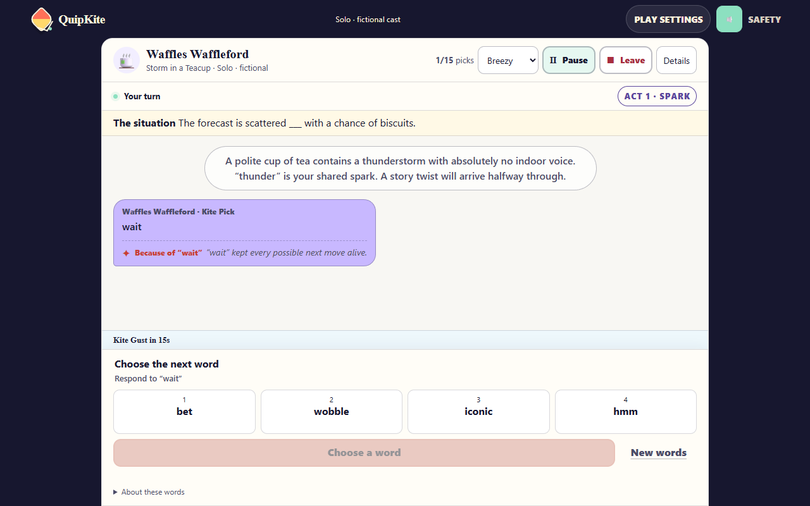

# QuipKite

**Small choices. Stories worth keeping.**

QuipKite turns word choices into short, illustrated stories. Solo play uses fictional companions: no real person is connected. It offers a low-pressure way to explore an idea, follow an unexpected turn, and keep an ending you like.

[Try the browser preview](https://zappytap.itch.io/quipkite-simulated-solo-preview) · [Inspect the review record](PROJECT_METADATA.json) · [Read the privacy boundary](PRIVACY.md)

## What it demonstrates

- **An easier starting point:** Choose from a small hand of words instead of composing a perfect opening message. The current situation and reply controls stay close together.
- **Room to reconsider:** Go back one choice while a choice-driven story is unfinished. Completed stories remain intact.
- **Useful recollection:** Optional “Kept before” markers recognize choices from the same path in a story already in your Collection. Unseen endings stay a surprise.
- **Progress that explains itself:** Named Storycraft discoveries, visible next goals and progress on Home help explain what was earned and what can be tried next.
- **Keepsakes with continuity:** Save favorite endings and return to explore another path without replacing the original.
- **Control over pace:** Timed or untimed word flights, adjustable text, reduced motion, pause/resume and responsive controls support different ways of playing.

## Why the design is useful

Small choices reduce blank-page pressure. A clear distinction between an unfinished story and a kept ending makes experimentation easier to understand. Progress is connected to new choices rather than a public popularity score.

For a reviewer, the project demonstrates stateful interface design, carefully bounded undo, recoverable local progress and clear separation between Solo play and a separate online experience.

## Try a short flight

Open the browser preview and complete its age and community prompts. Choose Solo, pick a fictional companion and a starting situation, then select a word and confirm it with **Send** when offered. Try a choice-driven story to explore **Back one choice** before finishing. Return to a kept story's path to inspect the optional recollection markers.

The image above is a genuine screenshot from an isolated run of the reviewed 0.36.0 browser package with fictional game state. It is not promotional artwork.

## Verification snapshot

The reviewed artifact is **0.36.0**, metadata revision **privacy.1**. Its archive identity, file inventories and privacy boundaries were checked, followed by isolated desktop/mobile loading, packaged privacy navigation and Solo-play checks. Application code and game assets are unchanged by this metadata revision. The [machine-readable review record](PROJECT_METADATA.json) identifies the exact artifact and limits.

## Contribution and rights

Game direction, review and release ownership are first-party work by Gateway Information Group LLC. Generative tools assisted portions of the code, copy and artwork derived from creator-owned QuipKite material. The repository contains a product overview and review evidence; Proprietary game source, internal plans, credentials and unpublished source builds are intentionally excluded. See [LICENSE.md](LICENSE.md).

This proposed refresh awaits comparison with the final hosted artifact before promotion. QuipKite is for adults 18+. The embedded Solo package keeps gameplay state on the device; the product page also links to separate browser Multiplayer requiring accounts and internet access. These checks do not establish two-player gameplay, account behavior, physical-device or screen-reader compatibility, or Norton clearance. Hosting platforms process information under their own policies.

Copyright © 2026 Gateway Information Group LLC. All rights reserved.
